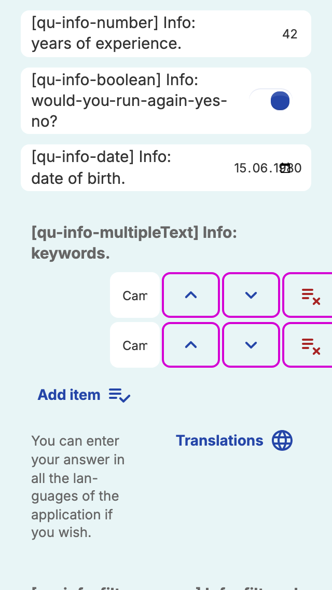
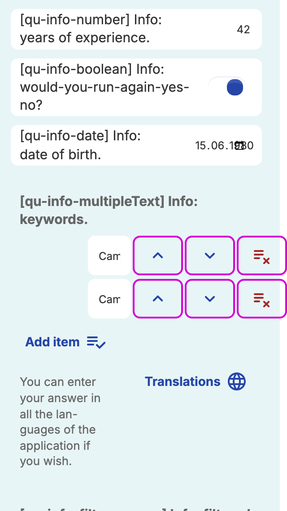

## Finding

A candidate's profile that holds a multiple-text info question is **8 px wider than the viewport at 320 px**, and not at 390 px. 1.4.10 Reflow fails on that page at that width.

### Measured

Runs `175-12-overflow-probe-base`, `175-12-overflow-probe` and `175-12-overflow-probe-after-r2`, on the base dataset's candidate:

- `documentElement.scrollWidth − clientWidth` is 8 at 320 px and 0 at 390 px and at 1280 px, the same in `en`, `fi` and `sv`.
- It is the same **before and after** the label fix of `64834c4e4`, and with every in-row label set to `white-space: normal` by a throwaway style. It is not the label defect.
- The elements beyond the viewport are the last of the three 56 px buttons of each row of the multiple-text question. A row of `MultipleTextPart.svelte` is a flex line of: the language label, 64 px and 20 px of margin, kept even while the translations are hidden and the label is transparent; the field, 48 px at its narrowest; and a group of three buttons that does not shrink, 172 px. That is 308 px in a 280 px column, so the last button, "remove", ends at 328.
- The organization-editing dataset's candidate, which has no such question, has no overflow at any width.

### Inferred, not measured

- That it is older than Phase 175: between the phase's base `c030a0d4f` and the head the file gained `lang`, the description and the focus wiring, and no class of the row changed. It was not opened in a browser on the base commit.
- That an organization's profile with a multiple-text question behaves the same: the part is the same, and the dataset has no such question for an organization.

## Screenshots

Taken 2026-10-09 for operator decision B6, with a throwaway probe that was not committed. It changed no product code.

| | Scrolled to the left edge (`scrollX` 0) | Scrolled to the right end (`scrollX` 8) |
|---|---|---|
| **With the three buttons of each row outlined** | [`…-320px-1.png`](assets/2026-10-09-175-multiple-text-row-320px-1.png) | [`…-320px-2.png`](assets/2026-10-09-175-multiple-text-row-320px-2.png) |
| As the page is drawn, nothing added | [`…-320px-1-plain.png`](assets/2026-10-09-175-multiple-text-row-320px-1-plain.png) | [`…-320px-2-plain.png`](assets/2026-10-09-175-multiple-text-row-320px-2-plain.png) |

**Measured at the moment of capture: `documentElement.scrollWidth − clientWidth` = 8** (328 − 320). The expected number.

- **Dataset and page:** the base dataset's candidate (the suite's `STORAGE_STATE` session), its profile at `/en/contestant/candidate/<id>/profile`, scrolled so that the question `[qu-info-multipleText] Info: keywords.` and its two rows are in view.
- **Locale:** `en` (`<html lang="en">`).
- **Viewport:** 320 × 568 CSS px, device scale factor 2, so each image is 640 × 1136. Chromium, the suite's `contestant-terms-gate-phone` project with the probe appended to its spec.
- **Commit:** `3c686fc8e`, whose tree outside `.planning/` is the one the screenshots show. This task did not change `MultipleTextPart.svelte`.
- **Runs:** `tests/e2e-runs/261009-b2-b3-b6-probe` and `-probe-r2`, through `tests/scripts/e2e-run.sh --no-db-reset --project contestant-terms-gate-phone`, 9 passed each, wrapper status 0, no void marker, AC power. The two runs' unannotated images are byte for byte the same. The probe, its launcher and every image and reading are kept under the ignored `tests/e2e-runs/261009-b2-b3-b6-probe.data/`.

### What the images show, and what they do not

- **In the page as drawn nothing looks cut off.** What runs past the right edge is the last 8 px of the third button's box, and that part of the box is empty: the "remove" icon sits in the middle of a 56 px box and is drawn wholly inside the viewport. The defect a user meets is that the page can be moved 8 px sideways, not a control they cannot see. That is why the first pair has the buttons outlined.
- **The outline moves nothing.** It is a 2 px `outline` with a negative offset, added by a style the probe injects; an outline takes no space. The reading was 8 before the style and 8 after it, at both scroll positions.
- **The boxes, in CSS px from the page's left edge** (the same for both rows): the row 20 to 300; the language label 30 to 94, `opacity: 0`, text "English"; the field 106 to 154; "move up" 156 to 212, "move down" 214 to 270, "remove" 272 to **328**. They are the numbers under *Measured* above.
- **Three descriptors, one reading.** The overflow is 8 with the phone descriptor the earlier runs used (`isMobile`, `hasTouch`, device scale factor 1), with the same at scale factor 2, and with a plain 320 px window (no `isMobile`, scale factor 2).
- **The images are of the plain 320 px window, not of the phone descriptor.** Under `isMobile` Chromium reports `window.innerWidth` 328 beside `clientWidth` 320, `window.scrollTo` does not move the page (`scrollX` stays 0), and the two screenshots of a pair are the same file. So the "scrolled to the right end" image could only be taken without `isMobile`. Whether a person holding a phone can pan the page those 8 px was **not tested**; no device was used.

### Seen in the same images, and not part of this todo

Reported, not measured further, and nothing was changed:

- **The field is 48 px wide and shows three letters of its value** ("Cam…") in both rows. At this width the row's text cannot be read while it is being edited, whichever option is taken for the 8 px.
- **In the date row the calendar icon is drawn over digits of the year** of "15.06.1980".
- **Under the phone descriptor the number row shows "4" of "42"** ([`…-320px-phone-descriptor.png`](assets/2026-10-09-175-multiple-text-row-320px-phone-descriptor.png)). The field's box is the same in both descriptors (212 to 292), so the digits are placed differently inside it. The cause was not looked into, and whether a real phone draws it so is unknown.

## The operator's direction, 2026-10-10

Given after the screenshots above, for whoever fixes this. The operator's words:

- Change inputs to render on two rows within narrow containers
- Remove left margin from multiple text inputs (or what looks like a margin)

Read against this todo, by the agent that filed the note and not confirmed with the operator:

- "Two rows within narrow containers" is the direction of option 2 below. It says containers, not viewports: the trigger is the width of the box the input sits in, which a viewport breakpoint does not measure.
- "What looks like a margin" at the left of a multiple-text row is, by the boxes under *Screenshots*, the language label: 30 to 94 px, `opacity: 0` while the translations are hidden, then 12 px to the field at 106. That is the reserved width option 1 below drops. No margin was measured on the input itself.
- The two are not alternatives; the direction asks for both.

## Options

1. **Drop the hidden label's reserved width.** While the translations are hidden the label is transparent and still takes 84 px. Without it the row is 224 px in 280. It changes where the field starts when the translations are toggled.
2. **Let the buttons move to a second line** under the field at narrow widths. The row grows taller; nothing shrinks below a 44 px target.
3. **Shrink the buttons.** Three 44 px targets and tighter gaps fit; the library's button size is then not the one used elsewhere.

Whichever is taken:

- Assert it where it was found: a page-width check on a profile that holds the question. `contestantProfilePage.expectFitsViewport()` is the step; the phase's page-width test of a candidate's profile uses the organization-editing dataset's candidate **because** the base dataset's overflows, so add the question to that dataset or assert on the base candidate once it fits.
- Re-measure at 1280 px with the method of `175-12-OVERFLOW-FIX.md` § At 1280 px: the box of every rendered element before and after.
